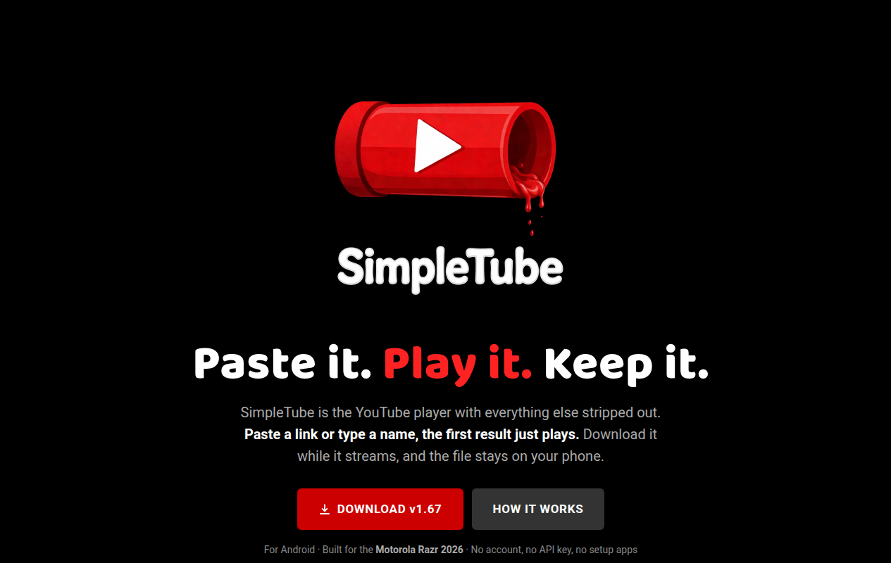
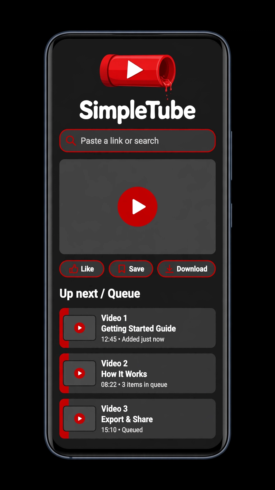
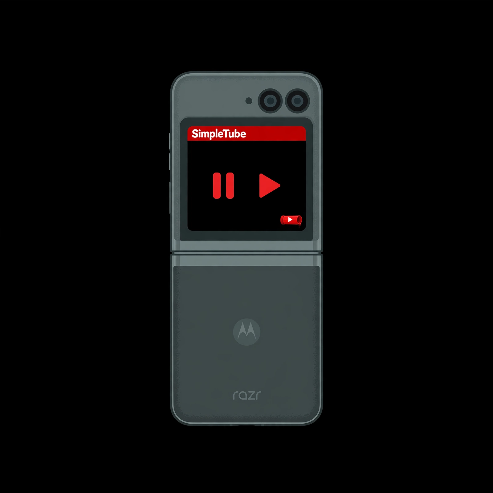
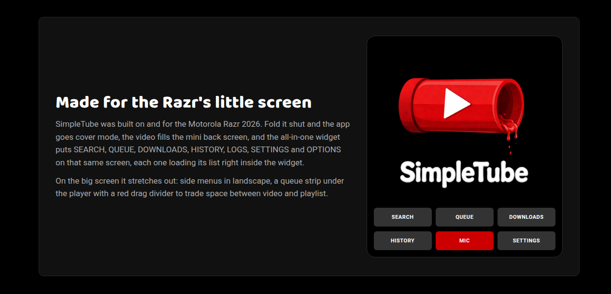

# SimpleTube

SimpleTube is a simple YouTube player for Android, built for the Motorola Razr. Paste a link or type a name, and the first result plays right away at the best quality on offer. Download it while it streams and the file stays on your phone.

Website: https://jordanalbiar.github.io/simpletube/

## How it works

## What it does

- Paste a YouTube link or search by name, the first result plays immediately
- Plays at the highest quality the video has, up to 2160p
- Downloads videos to keep on your phone, and plays them offline from its own file player
- Background audio, so the sound keeps going when you lock the screen or switch apps
- Queue with auto-advance, favorites, history, and a live terminal log
- Cover screen widget for the Razr, with the video filling the mini back screen
- Audio-only mode, sleep timer, and a Surprise Me shuffle

## The app

## Cover screen

## Install

1. Download **simpletube-v1.67.apk** from this repo, or from the website
2. Open the APK on your Android phone and allow installs from unknown sources when asked
3. Install it right over your current version. Your queue, favorites, and downloads carry over

Requires Android 8 or newer. It is not on the Play Store.

## v1.67

- Downloaded videos play with sound: the muxer writes with direct buffers, the file player sets its audio explicitly at full volume, and the log reports a file's audio samples on every play
- A downloaded file with no sound gets flagged for re-download instead of playing quiet
- All eight top buttons are one height
- The description stays visible with the logs open
- A single download bar at the top
- A fresh launch opens the home page
- A Buy me a cup of coffee button in Settings, at https://www.paypal.me/jordanalbiar

## Disclaimer

SimpleTube is an educational passion project, built for fun and not for profit. It is provided as is, with no warranty of any kind. Use it at your own risk.

It is not affiliated with, endorsed by, or connected to YouTube or Google in any way. YouTube is a trademark of Google LLC.

By downloading the APK, you accept full responsibility for the app, for installing it on your device, for how you use it, and for anything that follows from that. You are responsible for respecting creators and copyright, and for following the laws that apply to you. The app runs on your phone and sends nothing to my servers, and it collects no account or activity data. YouTube may observe the requests the app makes to play or fetch a video. If you do not accept that, do not install it.

## Credits

Built by Jordan Albiar. Video lookup and stream resolving use the open source NewPipeExtractor library.
