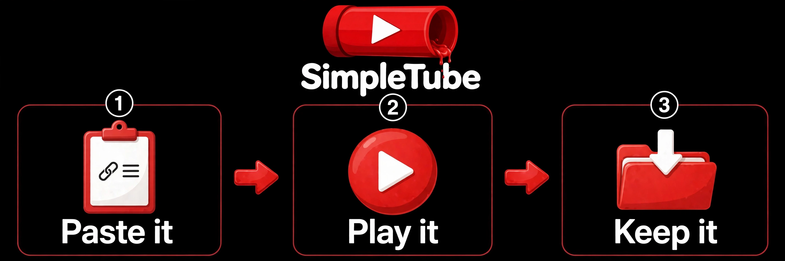
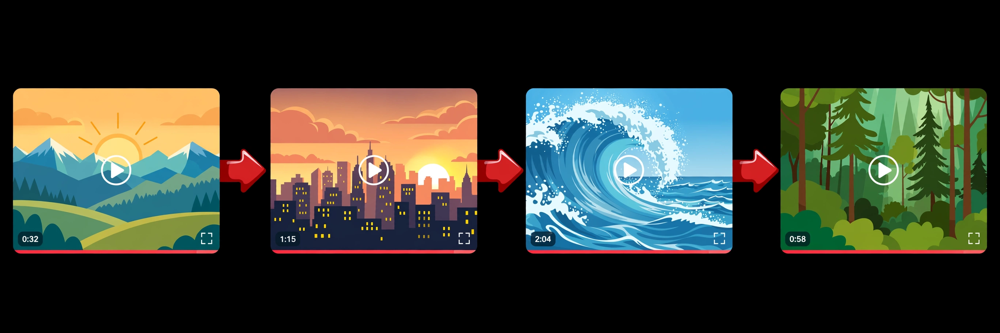
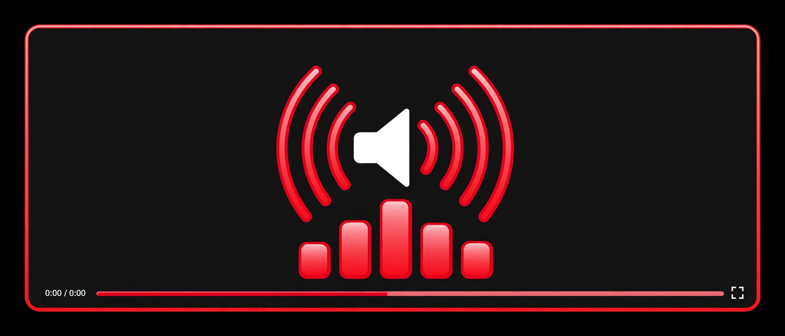
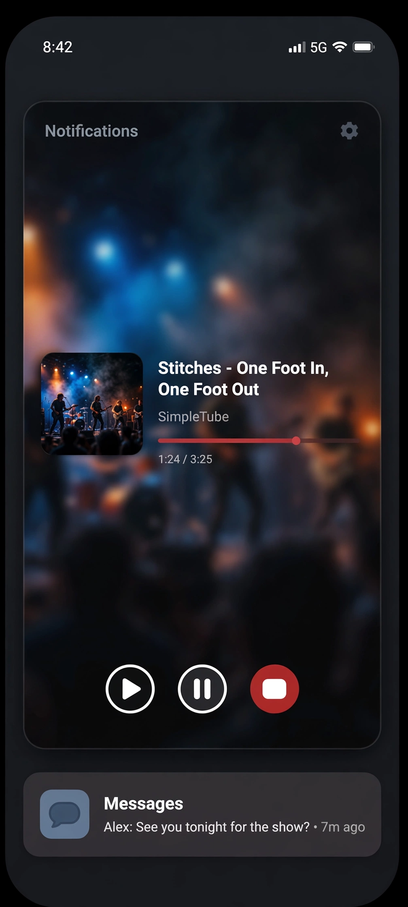
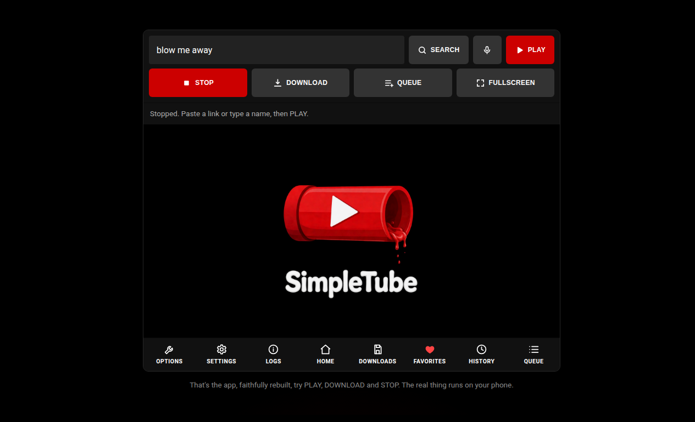

# SimpleTube

SimpleTube is a simple YouTube player for Android, built for the Motorola Razr. Paste a link or type a name, and the first result plays right away at the best quality on offer. Download it while it streams and the file stays on your phone.

Optimized for the Motorola Razr and Android 16.

Website: https://jordanalbiar.github.io/simpletube/

## How it works

## What it does

- Paste a YouTube link or search by name, the first result plays immediately
- Plays at the highest quality the video has, up to 2160p
- Downloads videos to keep on your phone, and plays them offline from its own file player
- Background audio, so the sound keeps going when you lock the screen or switch apps
- Queue with auto-advance, favorites, history, and a live terminal log
- Cover screen widget for the Razr, with the video filling the mini back screen
- Audio-only mode, sleep timer, and a Surprise Me shuffle
- Subscriptions feed from your followed channels, fetched fast over lightweight RSS, with an incremental refresh that only adds what is new since your last refresh
- Notification panel widget: what is playing or paused, with play, pause, and stop, on a custom card with the video thumbnail blurred behind it. Turn it off in Settings, App methods, like picture-in-picture
- Device performance presets: LOW, BALANCED, and HIGH, plus reset to defaults
- Widgets and picture-in-picture controls, with play, pause, next, and stop

## New illustration art

The new notification panel, with the video thumbnail blurred behind it.

## The app

## Cover screen

## Install

1. Download **simpletube-v1.92.apk** from this repo, or from the website
2. Open the APK on your Android phone and allow installs from unknown sources when asked
3. Install it right over your current version. Your queue, favorites, and downloads carry over

Requires Android 8 or newer. It is not on the Play Store. Optimized for the Motorola Razr and Android 16.

## v1.92

- Subscriptions load over lightweight RSS instead of full page scrapes, rows stay tappable while loading, and REFRESH only adds videos posted since your last refresh
- Feed scrollbars sit clear of the row buttons
- The logo video stops when a panel opens
- Top toolbar STOP and DOWNLOAD are icon-only
- Notification panel widget with an on/off toggle, custom card, blurred thumbnail background, and centered play, pause, and stop
- Audio only and sleep timer banners in the Utilities panel
- Widget play and resume fixed in picture-in-picture
- Thumbnail loads skip instead of crashing when the heap is nearly full
- Device performance presets LOW, BALANCED, and HIGH, plus reset to defaults
- Batched Takeout import that shows progress as channels are added
- Glossy red pill buttons, sliders, and toggles
- CLEAR ALL for the whole Following list, with a confirmation dialog
- Loading percentage inside the buffering spinners
- Icon-only pause buttons and top toolbar buttons, and a cleaner mini screen layout

## Disclaimer

SimpleTube is an educational passion project, built for fun and not for profit. It is provided as is, with no warranty of any kind. Use it at your own risk.

It is not affiliated with, endorsed by, or connected to YouTube or Google in any way. YouTube is a trademark of Google LLC.

By downloading the APK, you accept full responsibility for the app, for installing it on your device, for how you use it, and for anything that follows from that. You are responsible for respecting creators and copyright, and for following the laws that apply to you. The app runs on your phone and sends nothing to my servers, and it collects no account or activity data. YouTube may observe the requests the app makes to play or fetch a video. If you do not accept that, do not install it.

## Credits

Built by Jordan Albiar. Video lookup and stream resolving use the open source NewPipeExtractor library.
